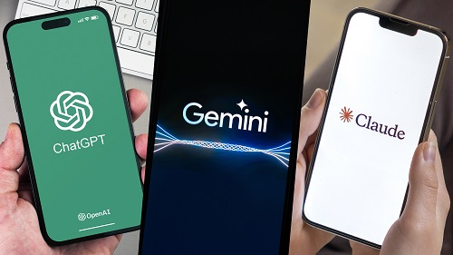

<!-- ==================== 顶部：Logo + 标题 + 一句话简介 ==================== -->

  

  <strong>全球顶尖大模型，一站直达。</strong>
   
  精选 ChatGPT、Gemini、Claude、Grok 等主流 AI 大模型官方入口，覆盖对话、编程、写作、搜索与分析全场景。

## 便捷使用入口

以下页面收录了多个第三方聚合站点与订阅服务，方便国内用户直连使用或进行订阅。

| 站点 | 类型 | 简述 | 使用入口 |
|---|---|---|---|
| OOOAI | 中文镜像 | 国内直连 ChatGPT、Claude、Gemini、Grok，隔离会话，隐私保护 | [点击访问](https://oai.oooai.cc/list/#/register?inviter=PCJVFH) |
| HopeAI | 中文镜像 | 国内直连多模型，原生官网体验 | [点击访问](https://chat.hopeai.cc/list/#/register?inviter=H8389H) |
| AskManyAI | 生产力平台 | ChatGPT、Claude、Gemini、Grok 使用入口 | [点击访问](https://askmany.top/login?i=c18638ff) |
| WildAI | 订阅服务 | ChatGPT Plus/Pro、Claude Pro/Max+、Grok Plus/Premium 等充值 | [点击访问](https://bewild.ai/?code=YANWEB) |
| 2233AI | 使用服务 | ChatGPT Plus、Claude Pro、Gemini Pro 日卡/月卡/季卡 | [点击访问](https://2233.ai/i/YANWEB) |
| 逍遥世界 | 订阅与账号 | ChatGPT Plus/Pro 充值，Gmail 账号、美区 Apple ID 购买 | [点击访问](https://xiaoyaoshijie.com/r/F1D2BB) |
> ⚠️ 以上聚合站均为第三方运营，与各官方网站无关联；请注意个人信息保护。
 

## 旗舰模型官网
| 模型 | 出品方 | 核心特点 | 官方入口 |
|---|---|---|---|
| **ChatGPT** | OpenAI | GPT 系列驱动，多模态，生态插件丰富，全球用户量最大 | [chatgpt.com](https://chatgpt.com/) |
| **Gemini** | Google | 原生多模态，深度整合搜索与 Workspace，超长上下文 | [gemini.google.com](https://gemini.google.com/) |
| **Claude** | Anthropic | 长文本处理与代码能力突出，Artifacts 实时交互 | [claude.ai](https://claude.ai/) |
| **Grok** | xAI | 实时接入 X 平台数据，回答风格犀利直接，具备图像理解能力 | [grok.com](https://grok.com/) |

